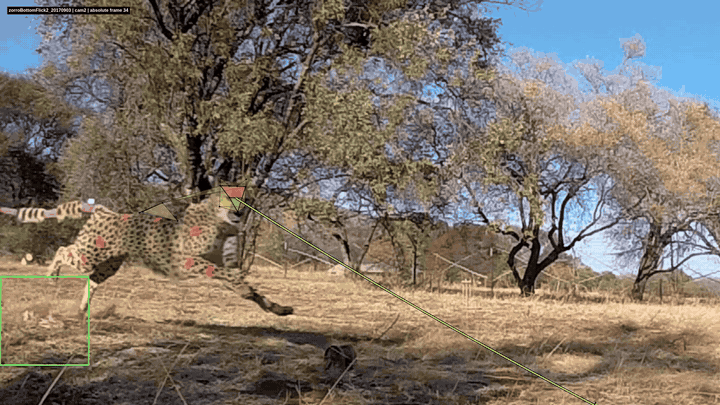

# CheetahHeadLab

**3D head–torso coordination during high-speed pursuit**

How do cheetahs keep their heads directed towards a moving target while running?
CheetahHeadLab reconstructs separate head and torso models and the lure trajectory
from multiview landmarks. Use it to study locomotor disturbance rejection,
target-relative orientation and the uncertainty in reconstructed animal movement.

[](docs/media/reconstruction.mp4)

*A close pass-by pursuit at 0.1× speed. The yellow arrow shows head-forward
direction. [Watch the MP4](docs/media/reconstruction.mp4). Footage: AcinoSet.
[Clip provenance](docs/media/PROVENANCE.md).*

## From landmarks to trajectories

CRBR is the full **Consensus-weighted Robust nonlinear least-squares
optimisation with Bidirectional constant-velocity smoothing for Reconstruction**
pipeline. Its stages are grouped under [`CRBR/`](CRBR/):
**spatiotemporal self-calibration → multiview
triangulation and camera selection → model scaling → nonlinear pose fitting →
bidirectional smoothing**, followed by optional joint Monte Carlo reconstruction.

The release includes corrected inputs for **18 pursuits from 6 cheetahs**,
reference trajectories and the **1,708 manuscript frame IDs** (1,590 for pitch).
Reconstruction lives in `CRBR/`, pitch analyses in `PitchAnalysis/`, and yaw
analyses in `YawAnalysis/`. The analysis code covers target alignment,
counter-rotation, pursuit geometry, Monte Carlo tracking states and the
candidate yaw models discussed in the paper.

## Reproduce one pursuit

Download or clone the repository and open MATLAB in its root folder. The tested
environment is **MATLAB R2026a on Linux**, with Optimization, Computer Vision,
Symbolic Math, Signal Processing and Image Processing Toolboxes. Behavioural
analyses also use Statistics and Machine Learning Toolbox. Parallel Computing
Toolbox is optional. Original videos are unnecessary for this step.

```matlab
run_reconstruction
addpath('tests')
check_reconstruction('outputs/julesBottomFlick2_20171209')
```

This fits all 69 frames of the default pursuit from the supplied self-calibrated
annotations, then compares the result with the reference. The example took
about 3.3 minutes and matched the reference exactly in the recorded validation.
[Validation details](docs/VALIDATION.md) include numerical differences in a second
pursuit and the extent of testing.

Outputs appear in `outputs/julesBottomFlick2_20171209/`:

| File | Contents |
|---|---|
| `poses.csv` | Head and torso rotations (radians), origins (metres) and frame IDs |
| `angles_and_lure.csv` | Lure positions and signed head/torso target errors (degrees) |
| `storedOptimRaw_trajectory.mat` | Reconstructed MATLAB trajectory |
| `reference_comparison.csv` | Framewise differences from the reference |
| `reproduction_summary.json` | Run settings, timing and comparison summary |

Yaw-error signs here follow the coordinate convention. Ahead/lagged
classification also requires target-travel direction. See
[data conventions](docs/DATA_AND_METHOD.md).

## Add uncertainty or choose another pursuit

```matlab
% After the default reconstruction: use the paper's 500 joint draws.
run_monte_carlo('outputs/julesBottomFlick2_20171209',500)

% Select another pursuit from manifest.json.
run_reconstruction('julesTopRun1_20171209')
```

Monte Carlo reconstruction refits poses and lure positions under annotation and
model-dimension uncertainty. It takes substantially longer than a nominal run.
For repeat runs, choose a fresh folder using `'outputRoot','outputs/repeat'`.

The [reproduction guide](docs/REPRODUCING.md) covers all 18 pursuits, parallel
execution, Python input checks and rerunning self-calibration. Corrected inputs
are supplied for every pursuit. One pursuit also includes its original inputs
for repeating the calibration stage.

## Reproduce the behavioural results

The saved nominal reconstructions and **500 joint Monte Carlo draws for all
18 pursuits** are included in `data/analysis_cache/` (about 47 MB).
Reviewers can reproduce the analyses without rerunning reconstruction:

```matlab
run_saved_analysis
```

Then install the Python dependencies and render the manuscript panels:

```bash
python -m pip install -r requirements.txt
python PitchAnalysis/plot_pitch.py
python YawAnalysis/plot_yaw.py
python YawAnalysis/compare_models.py
```

Tables and figures are written to `outputs/pitch/` and `outputs/yaw/`.
The standard workflow exports **20 manuscript panels**. See the
[figure inventory](docs/FIGURE_COVERAGE.md) for panel numbers and the example,
validation and illustration panels not yet generated by this release.
Run `python tests/check_figures.py` to check for missing or extra exports.
The [analysis guide](docs/ANALYSES.md) explains cohort selection, model
cross-validation, supplementary analyses and checks against manuscript tables.

## Paper and data

*Cheetahs Combine Head Pitch Stabilisation with Prospective Yaw Orientation during
High-speed Pursuit* — Shengyang Zhuang, Kamryn Norton, Jiahe Yu, Dimitrios Kanoulas
and Amir Patel.

Recordings and initial camera calibration originate from
[AcinoSet](https://github.com/African-Robotics-Unit/AcinoSet). This repository
provides the study's landmark annotations and refined camera geometry.
Use [`reference/manuscript_frames.csv`](reference/manuscript_frames.csv) to select
the analysed frames from the longer reconstruction windows.

[Reproduction guide](docs/REPRODUCING.md) ·
[Data and method conventions](docs/DATA_AND_METHOD.md) ·
[Validation](docs/VALIDATION.md) · [Pursuit manifest](manifest.json)

## Citation

If you use this code, please cite our [bioRxiv preprint](https://doi.org/10.64898/2026.09.03.748592).

```bibtex
@article{zhuang2026cheetahs,
  author = {Zhuang, Shengyang and Norton, Kamryn and Yu, Jiahe and
            Kanoulas, Dimitrios and Patel, Amir},
  title = {Cheetahs Combine Head Pitch Stabilisation with Predictive Yaw Tracking during High-speed Pursuit},
  journal = {bioRxiv},
  year = {2026},
  doi = {10.64898/2026.09.03.748592},
  url = {https://doi.org/10.64898/2026.09.03.748592}
}
```
